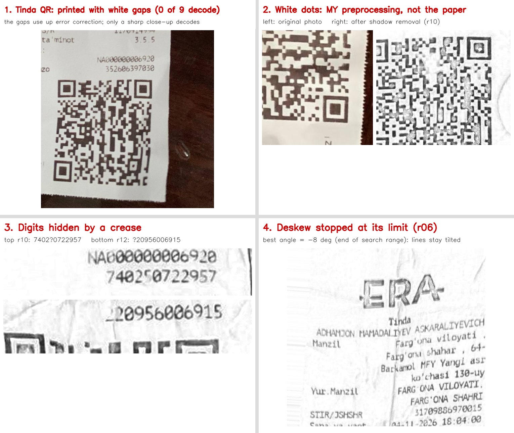

# Receipt recognition (OCR + QR) for Uzbek fiscal receipts

From a photo of a receipt the system recognises the text (Tesseract 5 / EasyOCR), decodes the
fiscal QR code (zxing-cpp + OpenCV), extracts the fields as JSON, checks the arithmetic and
compares the OCR values with the QR, and shows everything in a Gradio UI on CPU.

```
photo → preprocessing → OCR + QR → field extraction → reconciliation → JSON + metrics
         crop/mask,       2 engines   rules (uz-latn,     qty×price, Σ=total,
         deskew, light,               uz-cyrl, ru)        OCR ↔ QR
         contrast
```

**Baseline:** an OCR engine on the raw photo with no pre- or post-processing.
Every other configuration is compared with it on the same test split.

## Quick start

```bash
brew install tesseract tesseract-lang        # needs uzb, uzb_cyrl, rus traineddata
make setup                                   # Python 3.12 venv + pinned requirements.txt
make test                                    # unit tests
make app                                     # UI → http://127.0.0.1:7860
make split && make eval                      # all metrics → reports/results.md
```

`make eval` recomputes every metric with one command. OCR output is cached in `.cache/ocr`
together with its measured time, so a second run is fast and the timings stay honest.

## Layout

| Path | What |
|---|---|
| `configs/default.yaml` | every parameter (preprocessing steps, OCR languages, tolerances, experiments) |
| `src/receipt/preprocess.py` | receipt detection + perspective warp, background masking, deskew, illumination, CLAHE, binarization |
| `src/receipt/ocr.py` | Tesseract and EasyOCR behind one interface (lines with boxes and confidence) |
| `src/receipt/qr.py` | QR decoding with retries (ROI warp, upscale, CLAHE, Otsu, adaptive) and link parsing |
| `src/receipt/normalize.py` | numbers, apostrophes, look-alike letters, dates; **metric normalization rules** |
| `src/receipt/extract.py` | field and item extraction |
| `src/receipt/reconcile.py` | arithmetic checks, OCR ↔ QR comparison |
| `src/receipt/metrics.py` | CER, WER, field accuracy, item F1 |
| `scripts/evaluate.py` | engines × configs table, by condition and language, ablation, error analysis |
| `app.py` | Gradio UI |

## Output JSON

```json
{
  "seller_name": "...", "seller_tin": "31709886970015", "address": "...",
  "datetime": "2026-11-04T13:47:26", "receipt_number": "36785",
  "fiscal_module": "NA000000006920", "fiscal_sign": "352606397030",
  "items": [{"name": "Keks pishiriq", "quantity": 1.0, "price": 32000.0, "total": 32000.0}],
  "vat": 0.0, "total": 32000.0, "payment": "card",
  "qr": {"raw": "https://ofd.soliq.uz/...", "params": {"t": "...", "r": "...", "c": "...", "s": "..."},
         "fields": {"fiscal_module": "...", "receipt_number": "...", "datetime": "...", "fiscal_sign": "..."}}
}
```

Missing fields are `null`. `payment` is `cash`, `card` or `other`. The QR parameter → field mapping
lives in `configs/default.yaml` (`qr.param_map`).

## Dataset

| | |
|---|---|
| Unique receipts | 15 real paper receipts (Fergana, Oct–Nov 2026) from 3 sellers |
| Sellers | `era_tinda` (8 receipts, TIN 31709886970015), `era_barkamol` (5, TIN 31802964140017), `akmal_farm` (2, pharmacy) |
| Images | 48 = 16 real photos (one receipt shot twice) + 32 synthetic variants (`scripts/augment.py`) |
| With QR | 48 (every receipt prints a fiscal QR code) |
| Languages | Uzbek Latin (13 receipts), mixed Uzbek/Russian Cyrillic + Latin (2, pharmacy) |
| Split | seller-disjoint (`data/split.json`): **dev** = `era_tinda` (8 receipts, 27 images), **test** = `era_barkamol` + `akmal_farm` (7 receipts, 21 images) |
| Personal data | cardholder names and pharmacy staff names blacked out (`scripts/mask_pii.py`, checked by eye); card numbers are already masked by the terminal |

**Why synthetic variants.** Only 15 receipts could be collected, so each real photo got two
generated versions: (1) a shadow across the receipt + rotation, (2) faded print + blur + perspective +
strong JPEG compression. A variant shares the receipt id, seller and ground truth of its source photo
and therefore always sits in the same split: there is no leakage between dev and test.
They are marked `synthetic` in `data/meta.csv` and reported separately in the per-condition table.

**Ground truth.** `data/gt/<id>.json` holds the fields, items and QR text. The QR text of a receipt
whose code cannot be decoded was rebuilt from the printed fiscal module, receipt number, date and fiscal
sign; on the 4 codes that do decode the rebuilt text matches byte for byte. `data/gt/<id>.txt` holds the
full text line by line (test receipts only; logos and masked names are not part of the text).
`seller_name` is the shop name printed under the logo (logos are pictures, not text).

Parameters and rules were tuned on dev only; reported metrics are on test.
Public sets (SROIE, CORD) were not used for any reported number.

### Adding receipts

1. Mask personal data and put the photo in `data/images/` (e.g. `r07_a.jpg`, `r07_b.jpg` for two shots of receipt r07):
   `python scripts/mask_pii.py photo.jpg data/images/r07_a.jpg` (add `--box x0,y0,x1,y1` for anything it misses).
2. Add one row per photo to `data/meta.csv`:
   ```
   image,receipt_id,seller,lang,conditions,has_qr
   r07_a.jpg,r07,makro_yunusobod,uz_latn,clean,1
   r07_b.jpg,r07,makro_yunusobod,uz_latn,crumpled;shadow,1
   ```
   `lang`: `uz_latn`, `uz_cyrl`, `ru`, `mixed`. `conditions` (`;`-separated): `clean`, `crumpled`, `shadow`,
   `uneven_light`, `tilted`, `perspective`, `faded`, `long`, `handheld`.
3. `make prefill` writes draft ground truth `data/gt/<receipt_id>.json` and `.txt` from the pipeline.
   **Correct every value by hand** while looking at the paper receipt, then set `"_status": "verified"`.
   The `.txt` is the full text line by line in reading order (label and value on one line, as printed).
4. `make augment`, `make split`, then `make eval`.

## Metrics

Ground truth and prediction pass through the same normalization (`normalize.py`) before comparison:
NFC, apostrophes unified (oʻ/gʻ → U+02BB, others → U+02BC), whitespace collapsed, separator-only lines
removed, case ignored for CER/WER; amounts compared as numbers, digit fields as digits only.

* **CER** = (S + D + I) / N over characters (Levenshtein), aggregated over the corpus; can exceed 100 %.
* **WER**: same over words.
* **Field accuracy**: fields equal to ground truth / fields in ground truth (a `null` must be predicted as `null`).
* **Item F1**: an item counts only if name, quantity, price and total all match.
* **QR decoded**: decoded text equals the ground-truth QR text; *plain* = one attempt on the raw photo, *final* = after retries.
* **Consistent receipts**: Σ items = total holds and no check is a mismatch.
* **Speed**: mean seconds per receipt on CPU.

## Results

Test split: 21 images (7 real + 14 synthetic), 7 receipts, 2 sellers never seen during tuning
(MacBook CPU). Full tables: `reports/results.md`; dev split and ablation: `reports/dev/results.md`.

| engine | config | CER % | WER % | field acc % | item F1 % | QR plain % | QR final % | consistent % | s / receipt |
|---|---|---:|---:|---:|---:|---:|---:|---:|---:|
| Tesseract | baseline (raw photo) | 94.7 | 96.9 | 9.5 | 0.0 | 52.4 | 57.1 | 0.0 | 3.9 |
| Tesseract | + preprocessing | 50.2 | 83.6 | 17.6 | 0.0 | 52.4 | 57.1 | 0.0 | 6.1 |
| Tesseract | + pre + post-processing | 50.2 | 83.6 | **44.8** | 4.1 | 52.4 | 57.1 | 0.0 | 6.2 |
| EasyOCR | baseline (raw photo) | 79.8 | 97.3 | 10.5 | 0.0 | 52.4 | 57.1 | 0.0 | 43.0 |
| EasyOCR | + preprocessing | 52.7 | 84.1 | 20.5 | 0.0 | 52.4 | 57.1 | 4.8 | 17.3 |
| EasyOCR | + pre + post-processing | 52.7 | 84.1 | **44.3** | 0.0 | 52.4 | 57.1 | 0.0 | 17.5 |

Field accuracy with pre + post-processing, %:

| engine | seller | TIN | address | date | receipt no. | FM | fiscal sign | VAT | total | payment |
|---|---:|---:|---:|---:|---:|---:|---:|---:|---:|---:|
| Tesseract | 23.8 | 38.1 | 23.8 | 57.1 | 66.7 | 57.1 | 71.4 | 4.8 | 23.8 | 81.0 |
| EasyOCR | 9.5 | 47.6 | 28.6 | 66.7 | 71.4 | 61.9 | 61.9 | 23.8 | 19.0 | 52.4 |

Real vs synthetic test photos (pre + post): field accuracy 55.7 % vs 39.3 % (Tesseract),
60.0 % vs 36.4 % (EasyOCR).

**What the numbers say**

* Preprocessing halves the character error rate (CER 95 % → 50 % for Tesseract): on raw photos OCR
  reads the wooden table, the keyboard and sideways text. Post-processing does not change the text
  (CER is the same) but more than doubles field accuracy (18 % → 45 %): label rules, digit/apostrophe
  normalization, the dotted-zero repair and QR values.
* Tesseract and EasyOCR end up equal on fields; Tesseract is ~3× faster on CPU, so it is the default.
  EasyOCR is better on raw photos (lower CER) but worse on Cyrillic (it can only load Latin *or* Cyrillic).
* QR: retries add 4.7 points (52.4 % → 57.1 %). Only 4 of 16 real photos decode at all: one shop's
  printed codes are damaged and the others are crumpled (see below), which preprocessing cannot undo. When the QR decodes, its
  fiscal module, receipt number, date and fiscal sign are exact, which is why those fields are the best.
* "Consistent" is ~0 %: one wrong digit in an item or the total breaks Σ items = total, so this is a
  strict end-to-end measure. Item F1 is low for the same reason (all four attributes must match).
* WER stays high (~84 %) because one wrong character spoils a whole word and receipts are mostly
  short tokens (numbers, codes).

### Error analysis



1. **Dotted zero.** The ERA printer prints 0 with a dot inside; OCR reads it as 8, 6 or 9
   ("24 000.00" → "24 888.66"). `src/receipt/repair.py` uses the fact that the amount is printed 3–4 times
   (Narx, Naqdsiz, Jami, To'lov uchun jami): it lists what each copy could be if an 8/6/9 is a 0 and keeps
   the value the copies agree on; a value is never changed without support from another copy.
2. **QR codes that never decode.** Real photos decode by seller: ERA Tinda **0/9**, ERA Barkamol 2/5,
   Akmal Farm 2/2. The Tinda printer leaves white gaps in its codes (a worn thermal print head), which
   use up most of the QR error correction; zxing then fails with a checksum error as soon as anything
   else is wrong (code small in the frame, bent paper, blur). Separate sharp close-ups of r10 and r12 decoded
   on the first try, and their text matched our rebuilt ground truth exactly. On the other shops crumpling is
   what breaks the code. These fields then come from OCR only, and the OCR ↔ QR check says "нет данных".
3. **An artefact of my own preprocessing.** Background division (shadow removal) estimates the paper
   brightness with a large blur; inside a big black QR module that estimate is dark too, so the module
   turns partly white (panel 2: original vs preprocessed). It does not change the QR rate here (the codes
   fail on the original photo as well); the QR decoder works on the original photo first and uses the
   preprocessed image only as its last retry.
4. **Sideways photos** (7 of 16): handled by the orientation step (aspect ratio + Tesseract OSD).
5. **Deskew at its limit** (r06): the projection-profile search stopped at −8°, the edge of its range.
6. **Unreadable digits on paper**: two fiscal-sign digits were hidden by creases in the photos (r10, r12); both were checked on the paper receipts.

Automatic causes over all wrong fields (pre + post, both engines): *not found* 134, *text misread /
wrong span* 61, *digits/amounts misread* 20, *digits misread* 7, *date/time misread* 5,
*wrong line picked* 3, *digits missing/extra* 2, *spurious value* 1. Every wrong field is listed in
`reports/errors.csv` with its cause and shooting conditions; examples are in `reports/results.md`.

## Licenses

| Component | License |
|---|---|
| Tesseract 5 + tessdata (uzb, uzb_cyrl, rus) | Apache 2.0 |
| EasyOCR 1.7.2 and its models | Apache 2.0 |
| zxing-cpp 3.1.1 | Apache 2.0 |
| OpenCV 4.11 | Apache 2.0 |
| Gradio 6, pandas, RapidFuzz | Apache 2.0 / BSD / MIT |
| PyTorch 2.2.2 | BSD-3 |
| Dataset | own photos, personal data masked |
