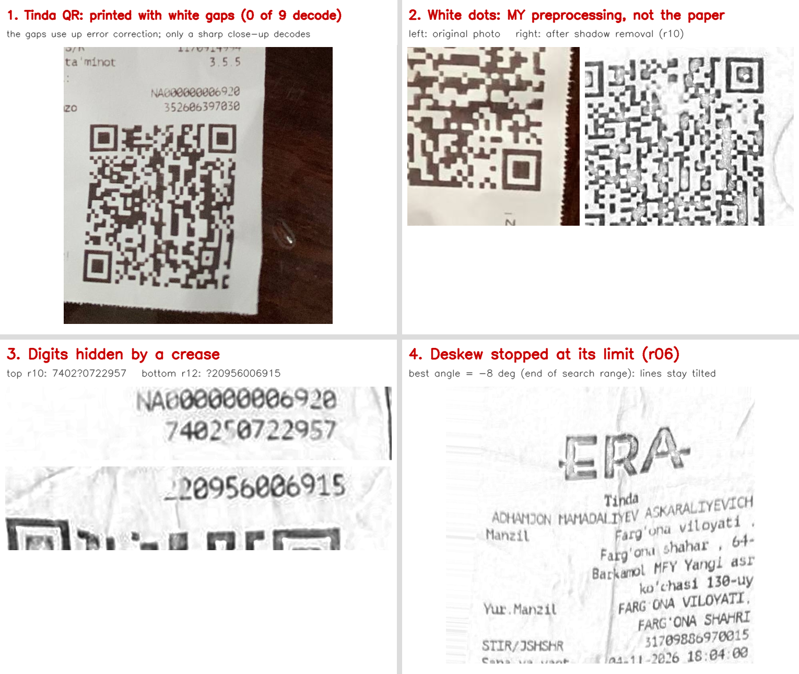

# Receipt recognition (OCR + QR) for Uzbek fiscal receipts

From a photo of a receipt the system recognises the text (Tesseract 5 / EasyOCR), decodes the
fiscal QR code (zxing-cpp + OpenCV), extracts the fields as JSON, checks the arithmetic and
compares the OCR values with the QR, and shows everything in a Gradio UI on CPU.

```
photo → preprocessing → OCR + QR → field extraction → reconciliation → JSON + metrics
         crop/mask,       2 engines   rules (uz-latn,     qty×price, Σ=total,
         deskew, light,               uz-cyrl, ru)        OCR ↔ QR
         contrast
```

**Baseline:** an OCR engine on the raw photo with no pre- or post-processing.
Every other configuration is compared with it on the same test split.

## Quick start

```bash
brew install tesseract tesseract-lang        # needs uzb, uzb_cyrl, rus traineddata
make setup                                   # Python 3.12 venv + pinned requirements.txt
make test                                    # unit tests
make app                                     # UI → http://127.0.0.1:7860
make split && make eval                      # all metrics → reports/results.md
```

`make eval` recomputes every metric with one command. OCR output is cached in `.cache/ocr`
together with its measured time, so a second run is fast and the timings stay honest.

## Layout

| Path | What |
|---|---|
| `configs/default.yaml` | every parameter (preprocessing steps, OCR languages, tolerances, experiments) |
| `src/receipt/preprocess.py` | receipt detection + perspective warp, background masking, deskew, illumination, CLAHE, binarization |
| `src/receipt/ocr.py` | Tesseract, EasyOCR and RapidOCR behind one interface (lines with boxes and confidence) |
| `src/receipt/repair.py` | repair of the dotted zero read as 8/6/9, using the copies of each amount printed on the receipt |
| `src/receipt/qr.py` | QR decoding with retries (crop of a code found but not read, WeChat CNN + super-resolution, ROI warp, CLAHE, Otsu, adaptive) and link parsing |
| `src/receipt/normalize.py` | numbers, apostrophes, look-alike letters, dates; **metric normalization rules** |
| `src/receipt/extract.py` | field and item extraction |
| `src/receipt/reconcile.py` | arithmetic checks, OCR ↔ QR comparison |
| `src/receipt/metrics.py` | CER, WER, field accuracy, item F1 |
| `scripts/evaluate.py` | engines × configs table, by condition and language, ablation, error analysis |
| `app.py` | Gradio UI |
| `scripts/mask_pii.py`, `scripts/augment.py` | masking of personal data; synthetic variants |
| `models/wechat_qrcode/` | WeChat QR detector + super-resolution models (OpenCV contrib) |

## Output JSON

```json
{
  "seller_name": "...", "seller_tin": "31709886970015", "address": "...",
  "datetime": "2026-11-04T13:47:26", "receipt_number": "36785",
  "fiscal_module": "NA000000006920", "fiscal_sign": "352606397030",
  "items": [{"name": "Keks pishiriq", "quantity": 1.0, "price": 32000.0, "total": 32000.0}],
  "vat": 0.0, "total": 32000.0, "payment": "card",
  "qr": {"raw": "https://ofd.soliq.uz/...", "params": {"t": "...", "r": "...", "c": "...", "s": "..."},
         "fields": {"fiscal_module": "...", "receipt_number": "...", "datetime": "...", "fiscal_sign": "..."}}
}
```

Missing fields are `null`. `payment` is `cash`, `card` or `other`. The QR parameter → field mapping
lives in `configs/default.yaml` (`qr.param_map`).

## Dataset

| | |
|---|---|
| Unique receipts | **29** real paper receipts (Fergana region, Oct–Nov 2026) from **7 sellers** |
| Sellers | `era_tinda` 8, `era_barkamol` 14, `akmal_farm` 3 (pharmacy, Cyrillic), `era_hamkorlik` 1, `diyor_neft` 1 (petrol station, own layout), `era_avtomobilist` 1, `era_avtogaz` 1 (gas stations) |
| Real photos | **78**: 49 whole-receipt photos + 29 photos of the lower half (totals + QR close-up) |
| Synthetic | 40 variants of the first 20 real photos (`scripts/augment.py`), reported separately |
| With QR | every receipt prints a fiscal QR code |
| Conditions | clean, crumpled, shadow, held in hand, tilted, sideways, blurred; synthetic: shadow, faded, perspective |
| Split | seller-disjoint (`data/split.json`): **dev** = `era_tinda`, `akmal_farm`, `era_hamkorlik`, `era_avtogaz` (13 receipts); **test** = `era_barkamol`, `diyor_neft`, `era_avtomobilist` (16 receipts) |
| Personal data | cardholder, cashier and pharmacy staff names blacked out (`scripts/mask_pii.py`, two OCR passes, every image checked); card numbers are already masked by the terminal |

**Lower-half photos** (`*_q.jpg`, condition `partial`) show only the totals and the QR code; they count for the
QR decode rate only, not for text or field metrics.

**Why synthetic variants.** The first 20 photos got two
generated versions: (1) a shadow across the receipt + rotation, (2) faded print + blur + perspective +
strong JPEG compression. A variant shares the receipt id, seller and ground truth of its source photo
and therefore always sits in the same split: there is no leakage between dev and test.
They are marked `synthetic` in `data/meta.csv` and reported separately in the per-condition table.

**Ground truth.** `data/gt/<id>.json` holds the fields, items and QR text. Every label was typed from the photos and then checked against the paper receipt. The QR text of a receipt
whose code cannot be decoded was rebuilt from the printed fiscal module, receipt number, date and fiscal
sign; on the 4 codes that do decode the rebuilt text matches byte for byte. `data/gt/<id>.txt` holds the
full text line by line (test receipts only; logos and masked names are not part of the text).
`seller_name` is the shop name printed under the logo (logos are pictures, not text).

Parameters and rules were tuned on dev only; reported metrics are on test.
Public sets (SROIE, CORD) were not used for any reported number.

### Adding receipts

1. Mask personal data and put the photo in `data/images/` (e.g. `r07_a.jpg`, `r07_b.jpg` for two shots of receipt r07):
   `python scripts/mask_pii.py photo.jpg data/images/r07_a.jpg` (add `--box x0,y0,x1,y1` for anything it misses).
2. Add one row per photo to `data/meta.csv`:
   ```
   image,receipt_id,seller,lang,conditions,has_qr
   r07_a.jpg,r07,makro_yunusobod,uz_latn,clean,1
   r07_b.jpg,r07,makro_yunusobod,uz_latn,crumpled;shadow,1
   ```
   `lang`: `uz_latn`, `uz_cyrl`, `ru`, `mixed`. `conditions` (`;`-separated): `clean`, `crumpled`, `shadow`,
   `uneven_light`, `tilted`, `perspective`, `faded`, `long`, `handheld`.
3. `make prefill` writes draft ground truth `data/gt/<receipt_id>.json` and `.txt` from the pipeline.
   **Correct every value by hand** while looking at the paper receipt, then set `"_status": "verified"`.
   The `.txt` is the full text line by line in reading order (label and value on one line, as printed).
4. `make augment`, `make split`, then `make eval`.

## Metrics

Ground truth and prediction pass through the same normalization (`normalize.py`) before comparison:
NFC, apostrophes unified (oʻ/gʻ → U+02BB, others → U+02BC), whitespace collapsed, separator-only lines
removed, case ignored for CER/WER; amounts compared as numbers, digit fields as digits only.

* **CER** = (S + D + I) / N over characters (Levenshtein), aggregated over the corpus; can exceed 100 %.
* **WER**: same over words.
* **Field accuracy**: fields equal to ground truth / fields in ground truth (a `null` must be predicted as `null`).
* **Item F1**: an item counts only if name, quantity, price and total all match.
* **QR decoded**: decoded text equals the ground-truth QR text; *plain* = one attempt on the raw photo, *final* = after retries.
* **Consistent receipts**: Σ items = total holds and no check is a mismatch.
* **Speed**: mean seconds per receipt on CPU.

## Results

Test split: 16 receipts from 3 sellers that were **never used for tuning** (ERA Barkamol, the
DIYOR NEFT petrol station, the ERA AVTOMOBILIST gas station; the petrol layout is not in dev at all).
CPU: MacBook (x86-64). All tables: `reports/results.md`; dev split and ablation: `reports/dev/results.md`.

### Real photos (23 whole-receipt photos)

| engine                        | config                  |   fields % |   item F1 % |   CER % |   WER % |   QR plain % |   QR final % |   consistent % |   s / receipt |
|:------------------------------|:------------------------|-----------:|------------:|--------:|--------:|-------------:|-------------:|---------------:|--------------:|
| Tesseract 5                   | baseline (raw photo)    |        7   |         0   |    88.9 |    93.5 |         47.8 |         60.9 |            0   |           7.9 |
| Tesseract 5                   | + preprocessing         |       20.4 |         5   |    33.3 |    67.8 |         47.8 |         60.9 |            4.3 |           9.2 |
| Tesseract 5                   | + pre + post-processing |       60   |        15   |    33.3 |    67.8 |         47.8 |         60.9 |            4.3 |           9.2 |
| EasyOCR                       | baseline (raw photo)    |       27.4 |         0   |    60.6 |    87.2 |         47.8 |         60.9 |            0   |          44.4 |
| EasyOCR                       | + preprocessing         |       33.5 |         0   |    23.5 |    69.3 |         47.8 |         60.9 |            4.3 |          23   |
| EasyOCR                       | + pre + post-processing |       59.6 |         0   |    23.5 |    69.3 |         47.8 |         60.9 |            0   |          20.2 |
| RapidOCR (PP-OCRv4, ONNX)     | baseline (raw photo)    |       57.4 |        35.6 |    47.7 |    65.8 |         47.8 |         60.9 |           26.1 |           7.9 |
| RapidOCR (PP-OCRv4, ONNX)     | + preprocessing         |       61.7 |        54.2 |    16.9 |    46.1 |         47.8 |         60.9 |           56.5 |           8.4 |
| RapidOCR (PP-OCRv4, ONNX)     | + pre + post-processing |       82.6 |        79.2 |    16.9 |    46.1 |         47.8 |         60.9 |           65.2 |           8.6 |
| Hybrid (RapidOCR + Tesseract) | baseline (raw photo)    |       57.4 |        35.6 |    47.7 |    65.8 |         47.8 |         60.9 |           26.1 |          11.5 |
| Hybrid (RapidOCR + Tesseract) | + preprocessing         |       61.7 |        54.2 |    16.9 |    46.1 |         47.8 |         60.9 |           56.5 |          12.7 |
| Hybrid (RapidOCR + Tesseract) | + pre + post-processing |       82.6 |        79.2 |    16.9 |    46.1 |         47.8 |         60.9 |           60.9 |          12.5 |

*s / receipt* in this table was measured while other experiments shared the CPU. A clean run (RapidOCR,
no OCR cache, nothing else running): **8.3 s mean**, 5.8 s median per receipt (preprocessing 0.35 s,
QR 5.1 s, OCR 2.9 s); QR retries on codes that do not decode take most of the time (worst receipt 26.5 s).

### Field accuracy per field (RapidOCR, pre + post, real photos)

|                          |   seller_name |   seller_tin |   address |   datetime |   receipt_number |   fiscal_module |   fiscal_sign |   vat |   total |   payment |
|:-------------------------|--------------:|-------------:|----------:|-----------:|-----------------:|----------------:|--------------:|------:|--------:|----------:|
| RapidOCR, real photos, % |            87 |         69.6 |      30.4 |       91.3 |               87 |            91.3 |            87 |  95.7 |    95.7 |      91.3 |

### Synthetic variants (14 photos: shadow + tilt, faded + blur + perspective + JPEG)

| engine                        | config                  |   fields % |   item F1 % |   CER % |   WER % |   QR plain % |   QR final % |   consistent % |   s / receipt |
|:------------------------------|:------------------------|-----------:|------------:|--------:|--------:|-------------:|-------------:|---------------:|--------------:|
| Tesseract 5                   | baseline (raw photo)    |        0.7 |         0   |    97.8 |    98.8 |         28.6 |         42.9 |            0   |           7.3 |
| Tesseract 5                   | + preprocessing         |       12.1 |         0   |    57.2 |    90.5 |         28.6 |         42.9 |            0   |           9.5 |
| Tesseract 5                   | + pre + post-processing |       35   |         0   |    57.2 |    90.5 |         28.6 |         42.9 |            7.1 |           9.5 |
| EasyOCR                       | baseline (raw photo)    |        5   |         0   |    85.2 |   100.5 |         28.6 |         42.9 |            0   |          45.4 |
| EasyOCR                       | + preprocessing         |       10.7 |         0   |    62.1 |    91.1 |         28.6 |         42.9 |            0   |          22.5 |
| EasyOCR                       | + pre + post-processing |       28.6 |         0   |    62.1 |    91.1 |         28.6 |         42.9 |            0   |          22.5 |
| RapidOCR (PP-OCRv4, ONNX)     | baseline (raw photo)    |       25.7 |         8.3 |    78.4 |    88.5 |         28.6 |         42.9 |           14.3 |           7.9 |
| RapidOCR (PP-OCRv4, ONNX)     | + preprocessing         |       26.4 |        27.3 |    50.5 |    76.6 |         28.6 |         42.9 |            7.1 |           8.3 |
| RapidOCR (PP-OCRv4, ONNX)     | + pre + post-processing |       50.7 |        36.4 |    50.5 |    76.6 |         28.6 |         42.9 |           21.4 |           9.2 |
| Hybrid (RapidOCR + Tesseract) | baseline (raw photo)    |       25.7 |         8.3 |    78.4 |    88.5 |         28.6 |         42.9 |           14.3 |           9.7 |
| Hybrid (RapidOCR + Tesseract) | + preprocessing         |       27.9 |        27.3 |    50.5 |    76.6 |         28.6 |         42.9 |            7.1 |          12.1 |
| Hybrid (RapidOCR + Tesseract) | + pre + post-processing |       52.9 |        36.4 |    50.5 |    76.6 |         28.6 |         42.9 |           28.6 |          11.9 |

### QR decoding by photo type

| kind      |   images |   QR plain % |   QR final % |
|:----------|---------:|-------------:|-------------:|
| lower half (QR close-up)   |       16 |         62.5 |         68.8 |
| whole receipt, real      |       23 |         47.8 |         60.9 |
| whole receipt, synthetic |       14 |         28.6 |         42.9 |

*QR plain* = one attempt on the raw photo; *final* = after retries (crop of the code zxing found but could
not read at several sizes, the same crop with printed gaps filled, WeChat CNN detector with
super-resolution, ROI warp, CLAHE, Otsu, …).

### Against the target values

| target | result (test, real photos) | status |
|---|---|---|
| field accuracy ≥ 85 % | **82.6 %** (VAT 95.7, total 95.7, date 91.3, FM 91.3, payment 91.3; address 30.4) | close; address is the main gap |
| item F1 ≥ 75 % | **79.2 %** | reached |
| QR decoded ≥ 95 % | **60.9 %** whole photo, **68.8 %** QR close-up | not reached: printed codes with gaps, crumpled paper |
| CER ≤ 10 %, WER ≤ 20 % | **16.9 % / 46.1 %**; 7.6–12.2 % CER on 7 of the 10 photos with full-text labels | not reached on average |
| arithmetic checks 100 % correct | **100 %**: on all 29 labelled receipts every check is "совпадает", and deliberately broken values are caught (`tests/test_reconcile.py`) | reached |
| ≤ 10 s per receipt on CPU | **8.3 s** mean (RapidOCR) | reached |

**What the numbers say**

* **From the baseline to the final system:** field accuracy 7 % → 82.6 %, item F1 0 → 79.2 %, CER 89 → 17 %.
* **The OCR engine matters most.** RapidOCR runs PaddleOCR's PP-OCRv4 models through ONNX Runtime; with the
  same pre- and post-processing it reaches 82.6 % field accuracy against 60 % for Tesseract and EasyOCR, and it
  is the fastest. It is the default engine.
* **Preprocessing** cuts CER by 2.5–3× for every engine (Tesseract 89 → 33 %, RapidOCR 48 → 17 %).
  **Post-processing** does not change the text but adds 21–40 points of field accuracy (label rules,
  dotted-zero repair, QR values) and turns item F1 from 54 % into 79 %.
* **Hybrid** (RapidOCR + Tesseract for what RapidOCR misses and for Cyrillic) gives the same accuracy on this
  Latin-only test split and is slower; it helps on the Cyrillic pharmacy receipts in dev.
* **Photo resolution decides QR decoding.** The first photos were sent through Telegram, which halves the
  resolution: 4 of 16 decoded. The same receipts re-shot at full resolution: 40 of 62.
* **Hard conditions still hurt:** on synthetic shadow / blur / perspective variants field accuracy is 50.7 %
  and QR 42.9 %.

### Preprocessing ablation (dev split, Tesseract, post-processing on)

Steps are added one by one, and each one is removed from the default; field accuracy, %:

| added step | real | synthetic | | default without | real | synthetic |
|---|---:|---:|---|---|---:|---:|
| none (raw photo) | 33.1 | 21.5 | | — (default) | 49.6 | 31.9 |
| + crop (find receipt, perspective) | 44.2 | 21.9 | | crop | 46.2 | 34.2 |
| + orient | 43.8 | 21.9 | | orient | 49.6 | 30.4 |
| + deskew | 46.9 | 23.5 | | deskew | 50.0 | 25.8 |
| + illumination (shadow removal) | 44.6 | 30.0 | | illumination | 43.8 | 26.5 |
| + CLAHE (contrast) | **49.6** | **31.9** | | CLAHE | 44.6 | 30.0 |
| + binarize | 34.6 | 23.8 | | | | |

* **Cropping** gives the largest single gain on real photos (+11 points): without it OCR also reads the table
  and background.
* **Shadow removal and CLAHE** matter most for hard conditions: on the synthetic shadow / faded photos
  illumination adds 6.5 points, and removing either step costs 5–6 points on real photos.
* **Deskew and orientation** help on the tilted synthetic photos (−6.1 and −1.5 points without them) and are
  neutral on the real photos, which were mostly shot straight.
* **Binarization hurts** (49.6 → 34.6): it breaks the thin strokes of thermal print, so it is off by default.
  All these choices were made on dev only.
* Ablation was run with Tesseract before the last orientation fix (see error analysis), which changed the
  preprocessing of 4 dev photos.

### Error analysis



1. **Dotted zero.** The ERA printer prints 0 with a dot inside; OCR reads it as 8, 6 or 9
   ("24 000.00" → "24 888.66"). `src/receipt/repair.py` uses the fact that the amount is printed 3–4 times
   (Narx, Naqdsiz, Jami, To'lov uchun jami): it lists what each copy could be if an 8/6/9 is a 0 and keeps
   the value the copies agree on; a value is never changed without support from another copy.
2. **Photo resolution decides the QR rate.** The first 16 photos came through Telegram, which halves
   the resolution: 4 of 16 decoded (ERA Tinda 0 of 9). The same receipts re-shot at full resolution: 40 of 62.
3. **Printed gaps in the QR code.** The ERA Tinda printer leaves white gaps inside black modules
   (a worn thermal print head). They use up most of the QR error correction, so zxing fails with a checksum
   error as soon as anything else is wrong. A retry binarizes the crop of the code that zxing found and
   thickens the black to fill the gaps (dev: 18 → 21 of 39 real photos decoded).
4. **An artefact of my own preprocessing.** Background division (shadow removal) estimates the paper
   brightness with a large blur; inside a big black QR module that estimate is dark too, so the module turns
   partly white (panel 2). The QR decoder therefore works on the original photo first.
5. **Orientation detector turned upright receipts upside down.** Tesseract OSD claimed "rotate 180°" on 10
   upright receipts; one of them (r11_c) was flipped and its text came out in reverse order (CER 81 %). Now a
   receipt is turned only when its own layout says so: the fiscal QR code is printed at the end, so a QR code
   found in the top 40 % means upside down (0 of 49 upright photos rotated, 39 of 49 flipped copies corrected).
   Sideways photos are turned by the aspect ratio of the receipt.
6. **Strong shadow cuts a hole in the receipt** (r20_a): the paper mask treats the shadowed half as
   background. Not fixed yet.
7. **Deskew at its limit** (r06): the projection-profile search stopped at −8°, the edge of its range.
8. **Long addresses** (field accuracy 26 %): one wrong letter in a 70-character address makes the field wrong,
   and wrapped address lines are sometimes cut. The metric is exact match, as required.

Automatic causes of the wrong fields (RapidOCR, pre + post, test): *not found* 57, *text misread /
wrong span* 35, *digits misread* 6, *digits/amounts misread* 5, *digits missing/extra* 3, *date/time misread* 3. Every wrong field is listed in
`reports/errors.csv` with its cause and shooting conditions; examples are in `reports/results.md`.

## Licenses

| Component | License |
|---|---|
| Tesseract 5 + tessdata (uzb, uzb_cyrl, rus) | Apache 2.0 |
| EasyOCR 1.7.2 and its models | Apache 2.0 |
| zxing-cpp 3.1.1 | Apache 2.0 |
| OpenCV 4.11 | Apache 2.0 |
| Gradio 6, pandas, RapidFuzz | Apache 2.0 / BSD / MIT |
| PyTorch 2.2.2 | BSD-3 |
| RapidOCR 1.4.4 + PaddleOCR PP-OCRv4 models | Apache 2.0 |
| ONNX Runtime 1.20 | MIT |
| WeChat QR models (opencv_3rdparty) | Apache 2.0 |
| Dataset | own photos, personal data masked |
